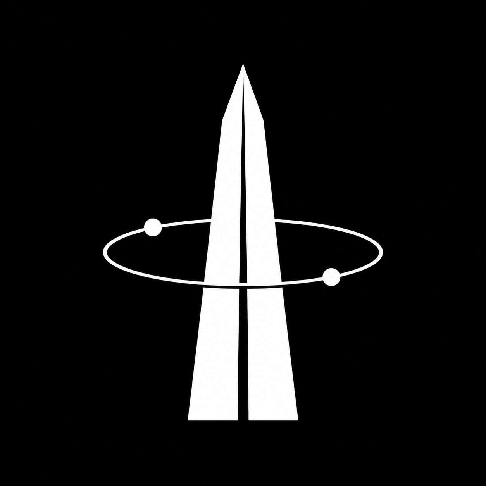
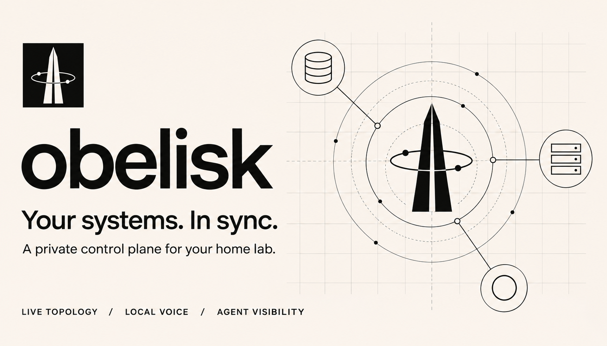
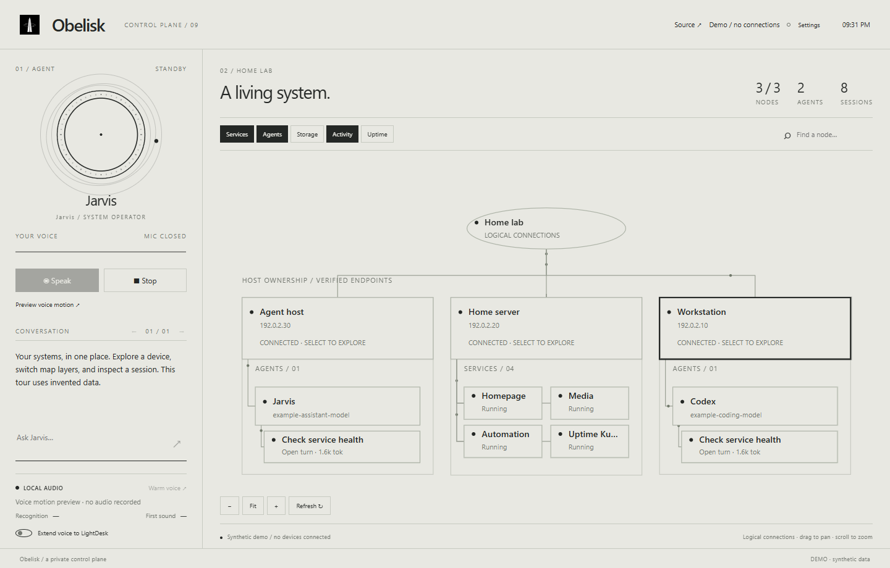
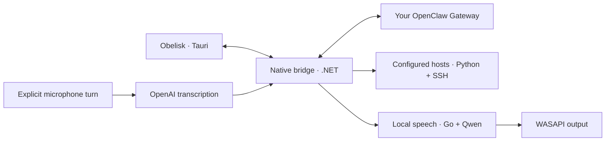

<div align="center">

<a href="https://maxjafar.github.io/obelisk/"></a>

# Obelisk

**Your systems. In sync.**

A private control plane for your home lab.<br />See your devices. Follow your agents. Speak to Jarvis.

[](https://github.com/MaxJafar/obelisk/actions/workflows/checks.yml)
[](docs/SETUP.md)
[](LICENSE)
[](CHANGELOG.md)

**[Interactive tour](https://maxjafar.github.io/obelisk/tour/)** · **[Get started](#make-it-yours)** · **[Architecture](docs/ARCHITECTURE.md)** · **[Privacy](docs/PRIVACY.md)** · **[Contribute](CONTRIBUTING.md)**

</div>

<a href="https://maxjafar.github.io/obelisk/tour/"></a>

<p align="center"><sub>One quiet surface for a living system. Original generated artwork; the tour and screenshots use invented data.</sub></p>

## A map you can use

Your home lab has a shape. Obelisk makes it visible: devices connect to their services, agents connect to their sessions, and storage stays close to the machine that owns it. Pan, zoom, isolate a host, switch layers, or open a node to act on it.

The interface is flat and monochrome. Thin lines, proper ellipses, small moving dots. Jarvis has a circular voice visualizer; your microphone has its own waveform. Obelisk is the system. Jarvis is its operator.

| Surface | What you can do |
| --- | --- |
| **Devices** | Follow availability, uptime, CPU, memory and storage across configured Windows, Linux and macOS hosts. |
| **Services** | Import Homepage bookmarks, open configured endpoints, inspect Uptime Kuma history, and start or stop explicitly allowed Docker containers. |
| **Agents** | Inspect supported Codex, OpenClaw and Hermes metadata: models, sessions, reported tokens and tool activity. Missing usage stays missing; stale activity is marked. |
| **Voice** | Talk to an OpenClaw agent, stream replies through local Qwen, interrupt playback, and see separate input/output audio motion. |
| **LightDesk** | Send bounded playback levels to a compatible local lighting adapter, with a restoration handshake when speech ends. The adapter is optional and separate. |

<a href="https://maxjafar.github.io/obelisk/tour/"></a>

<p align="center"><strong><a href="https://maxjafar.github.io/obelisk/tour/">Explore the live tour ↗</a></strong><br /><sub>Toggle layers, inspect nodes, explore a host and preview voice motion. No sign-in, microphone access or connection to your devices.</sub></p>

## Make it yours

**0.9.0 is a Windows source alpha.** The desktop app uses Tauri, a .NET bridge and a Go audio supervisor. Linux and macOS are supported as configured telemetry hosts; desktop builds for those systems are not included. There is no signed installer or automatic updater in this release.

<details open>
<summary><strong>01 / Try it without connecting anything</strong></summary>

Open the **[interactive tour](https://maxjafar.github.io/obelisk/tour/)**. It runs the real interface with a synthetic, read-only adapter. Its values and voice motion are demonstrations, not measurements.

To serve it locally, clone the repository, run `python -m http.server 8080 --bind 127.0.0.1 --directory docs`, and open `http://localhost:8080/tour/`.

</details>

<details>
<summary><strong>02 / Build the native Windows app</strong></summary>

Install .NET 10 SDK, Rust with the MSVC toolchain and C++ build tools, Go 1.27+, Python 3.10+, and Microsoft WebView2. See the [full setup guide](docs/SETUP.md) for prerequisites and optional dependencies.

```powershell
git clone https://github.com/MaxJafar/obelisk.git
cd obelisk
powershell -NoProfile -ExecutionPolicy Bypass -File tauri/Build-Obelisk.ps1
.\tauri\publish\Obelisk.exe --preview
```

Remove `--preview` when you want to configure your own system. The launch script is `Start-Obelisk.ps1`. Build tools and model downloads are not bundled into Git.

</details>

<details>
<summary><strong>03 / Connect your home lab and agent</strong></summary>

Use **Settings** in the app to enter your Gateway URL, agent ID and optional pairing token. Approve the device on your own Gateway. Begin with text; voice is optional.

Copy [`examples/homelab.example.json`](examples/homelab.example.json) to `%LOCALAPPDATA%/Obelisk/homelab.json`. For multiple hosts, adapt the [multi-host example](examples/homelab.multi-host.example.json) and configure verified SSH aliases. Examples use reserved documentation addresses, not a real network.

Providers and service controls are opt-in. The first run collects only this computer's basic resources. [Connection and control guide →](docs/SETUP.md#connect-your-home-lab)

</details>

<details>
<summary><strong>04 / Add your voices</strong></summary>

The optional speech engine uses Qwen3-TTS 1.7B Base Q8 through a pinned llama.cpp CUDA runtime. It accepts separate English and Russian reference WAV recordings that you have permission to use. Personal recordings are never included in this repository.

```powershell
powershell -NoProfile -ExecutionPolicy Bypass -File tools/Prepare-Audio.ps1
powershell -NoProfile -ExecutionPolicy Bypass -File tools/Import-Voices.ps1 -EnglishWav .\english.wav -RussianWav .\russian.wav
```

Downloads total about 3.1 GB before extraction. Use an NVIDIA GPU and driver compatible with the pinned CUDA runtime. The desktop and text interface work without it; other GPU backends are not packaged yet.

**Speech output is local. Voice input uses OpenAI transcription** and requires your own API key, entered in Settings. Audio is sent only during an explicit microphone turn. Your Gateway determines where agent requests run. [Audio setup and limitations →](docs/SETUP.md#voice)

</details>

## Built for your own infrastructure

Configuration, tokens, caches, models and recordings live outside the checkout. Gateway credentials and the transcription key are encrypted with Windows DPAPI. Local inference listens on loopback and requires a generated credential. SSH uses existing keys and strict known-host verification.

Service actions require an explicit allowlist, a fresh observation and the same container identity. The diagram shows logical ownership and observed connections; it does not infer physical cables or guarantee a service is healthy just because its host is reachable.

[Read the privacy boundaries](docs/PRIVACY.md) · [Report a vulnerability privately](SECURITY.md)

## Under the surface



The UI stays small: HTML, CSS, SVG and canvas, with no frontend framework or bundler. Native work happens in owned processes. Audio features follow actual PCM playback; polling and animation pause when the window is hidden. [Architecture and extension points →](docs/ARCHITECTURE.md)

## Develop with Obelisk

```powershell
python -m unittest discover -s tests -v
dotnet run --project windows/JarvisHud.HomelabChecks -- examples/demo-snapshot.json
dotnet run --project windows/JarvisHud.AudioChecks
```

Run `go test ./...` from `audio-engine`. [Contributing](CONTRIBUTING.md) covers the full checks, demo regeneration and public-data rules. Changes to the source, documentation and integrations are welcome.

First-party code and original branding are available under **[0BSD](LICENSE)**, the same permissive license used by [Monolith](https://github.com/MaxJafar/monolith). Dependencies, models and optional runtimes retain their [own licenses](THIRD_PARTY_NOTICES.md).
